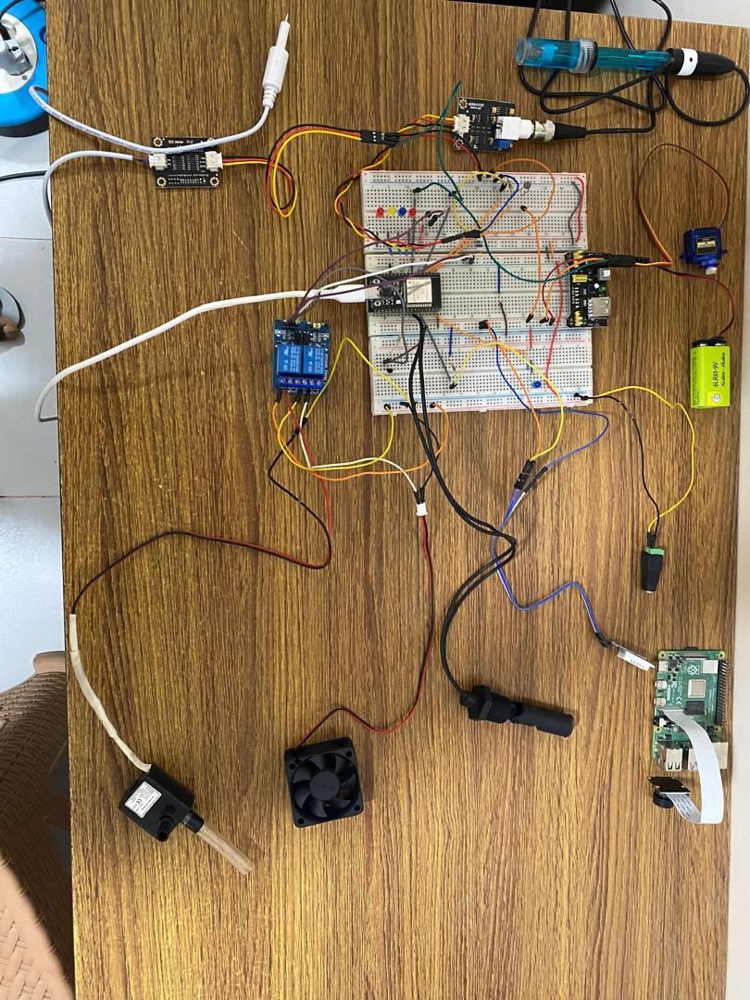
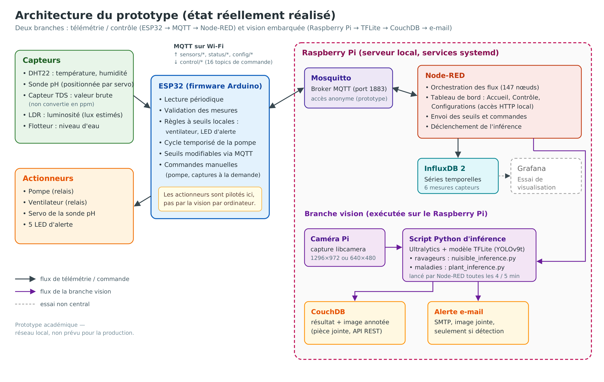
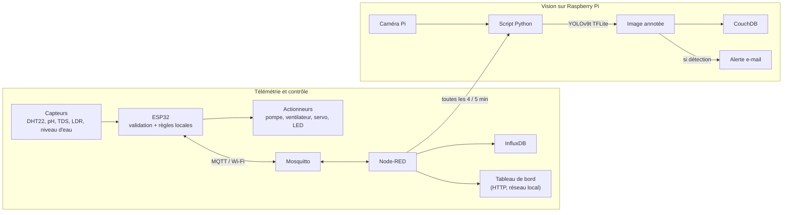
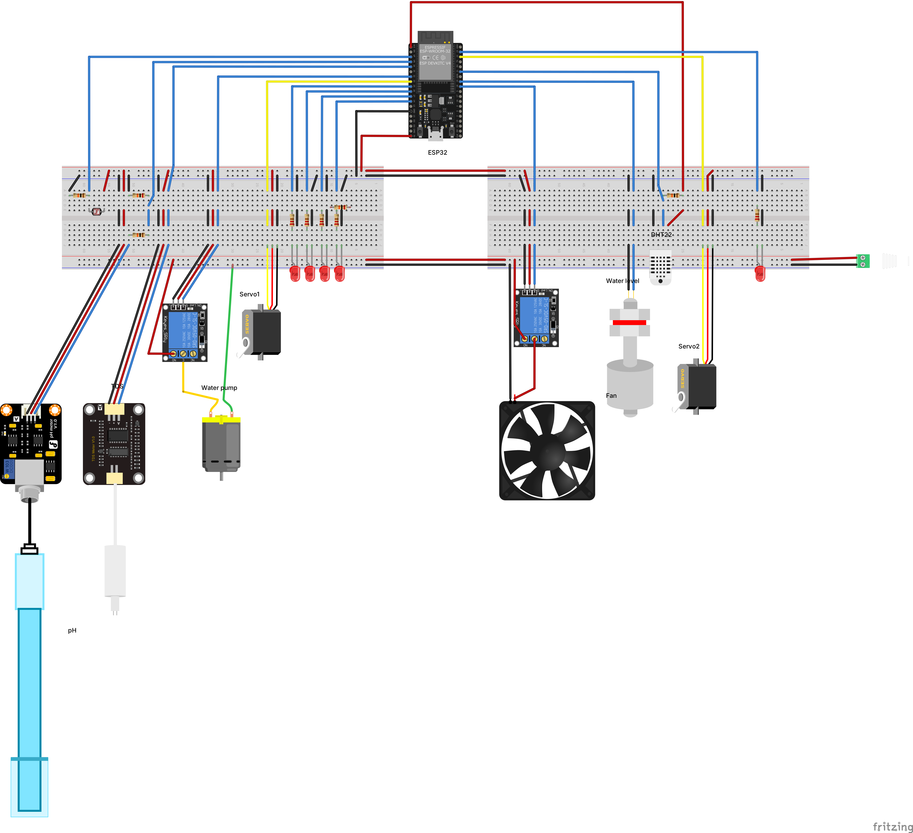
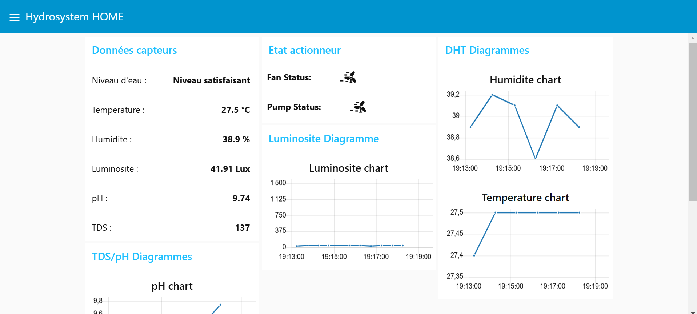
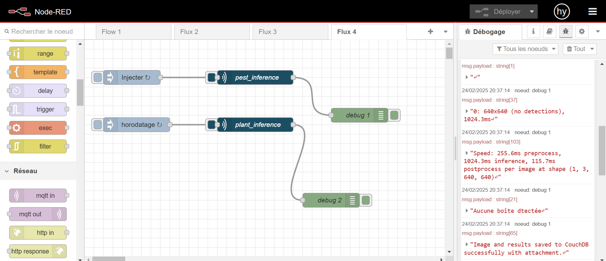
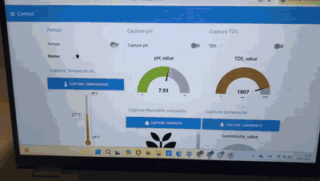
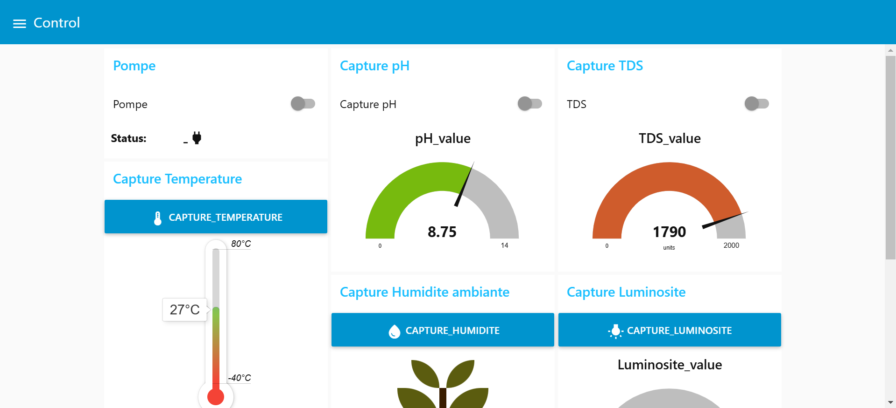
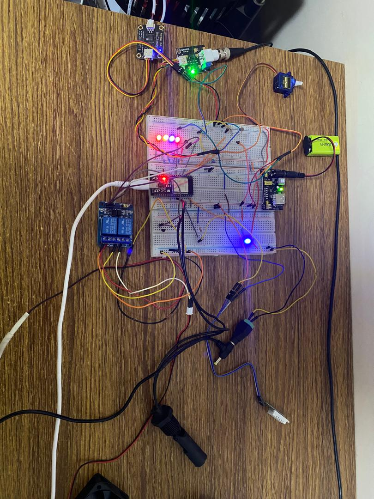

# Système AIoT de supervision d'une culture hydroponique

Prototype académique qui combine IoT, supervision et Computer Vision embarquée, développé dans le cadre de mon mémoire de Master IA & Smart Technologies (2024–2025).

> **Prototype académique** — il n'a pas été conçu comme un système prêt pour la production.



## En bref

- **Projet individuel** — mémoire de Master IA & Smart Technologies, 2024–2025
- **Architecture** — ESP32 · MQTT · Node-RED · Raspberry Pi
- **Computer Vision** — YOLOv9t, mAP50 **0,865 sur validation**
- **Edge inference** — environ **1 s/image** observé sur le Raspberry Pi du prototype

---

## 1. Présentation

Ce prototype surveille une petite culture hydroponique de laitue. Un **ESP32** lit les conditions du milieu (température, humidité, pH, TDS, luminosité, niveau d'eau), les valide puis les publie en **MQTT**. Il pilote aussi un ventilateur, une pompe et des voyants à partir de règles simples. Sur un **Raspberry Pi**, **Node-RED** reçoit ces mesures, les enregistre dans **InfluxDB** et les affiche sur un tableau de bord. Node-RED lance aussi, à intervalles réguliers, une **détection visuelle de ravageurs et de maladies** (YOLO exporté en TFLite) à partir de la caméra du Pi.

### English summary

Academic AIoT prototype for hydroponic lettuce: an ESP32 publishes sensor telemetry over MQTT and drives a fan, a pump and alert LEDs with simple local rules. A Raspberry Pi runs Node-RED (dashboard, InfluxDB storage) and periodic YOLO/TFLite inference on camera images, with results stored in CouchDB and e-mail alerts. Learning prototype, not production-ready.

---

## 2. Problématique

Mon mémoire partait d'une question plus large : la gestion de l'eau, la surveillance des cultures et l'optimisation de l'espace en culture hors-sol, dans le contexte du Sénégal. Le prototype en retient une partie :

> **Comment réunir dans un même prototype des capteurs, une automatisation simple, un tableau de bord et la vision par ordinateur, pour suivre une culture hydroponique et réduire certaines interventions manuelles ?**

---

## 3. Ce que j'ai réalisé

Projet **individuel** : j'ai réalisé chacune des étapes suivantes.

- **Montage électronique** : câblage de l'ESP32, des capteurs, des relais, du servomoteur et des voyants. Le schéma Fritzing est dans [`hardware/`](hardware/).
- **Firmware ESP32** (Arduino) : lecture périodique des capteurs, validation des mesures, règles de commande des actionneurs, **seuils modifiables à distance** et commandes manuelles via MQTT.
- **Communication MQTT** avec un broker Mosquitto installé sur le Raspberry Pi.
- **Orchestration et tableau de bord Node-RED** : 147 nœuds, 3 pages (Accueil, Contrôle, Configurations) et 10 curseurs de réglage des seuils.
- **Stockage des séries temporelles** dans InfluxDB 2.
- **Computer Vision** : préparation et réannotation des données, entraînement et évaluation de modèles YOLO sur Google Colab, export TFLite.
- **Scripts d'inférence sur le Raspberry Pi** : capture de l'image, inférence, image annotée enregistrée dans **CouchDB**, **alerte e-mail** quand quelque chose est détecté.
- **Mise en service** des services au démarrage du Raspberry Pi (systemd).
- **Calibration expérimentale** de la LDR (avec un luxmètre sur smartphone) et du pH (sans solution tampon, voir les limites).

---

## 4. Architecture du système



*Version vectorielle : [`docs/architecture/system_architecture.svg`](docs/architecture/system_architecture.svg)*

Le système comporte deux branches qui fonctionnent indépendamment l'une de l'autre :



Dans `flows.json`, deux nœuds *inject* lancent les scripts de vision toutes les **4 minutes** (ravageurs) et **5 minutes** (maladies). Un e-mail n'est envoyé que si au moins un objet est détecté. Tous les services serveur (Mosquitto, Node-RED, InfluxDB, CouchDB) tournent sur le **même Raspberry Pi**, sur le réseau local.

> Le mémoire contient des schémas plus anciens. Ils décrivent un « module de décision » qui n'a pas été implémenté sous cette forme. Le schéma ci-dessus a donc été redessiné à partir du code réellement retrouvé.

---

## 5. Matériel

Ces composants sont confirmés par le firmware et le schéma Fritzing :

| Rôle | Composant |
|---|---|
| Microcontrôleur | ESP32 DevKitC V4 |
| Température / humidité | DHT22 |
| pH | Sonde pH analogique, positionnée par un servomoteur |
| Nutriments | Capteur TDS analogique (valeur brute) |
| Luminosité | Photorésistance (LDR) |
| Niveau d'eau | Interrupteur à flotteur |
| Actionneurs | Pompe à eau et ventilateur (via modules relais), 5 LED d'alerte |
| Edge / serveur | Raspberry Pi (Raspberry Pi 4 Model B selon le mémoire) |
| Caméra | Caméra Raspberry Pi utilisée avec `libcamera` (Pi Camera v2 selon le mémoire) |

Le schéma Fritzing prévoit un second servomoteur, destiné au capteur TDS, mais il est **désactivé dans le firmware final**.


*Vue breadboard exportée depuis le fichier Fritzing du dépôt ([`hardware/`](hardware/), version vectorielle : [`montage_breadboard.svg`](hardware/montage_breadboard.svg)).*

---

## 6. Stack technique

| Fonction | Technologies |
|---|---|
| Embarqué | ESP32, Arduino (C++), bibliothèques `PubSubClient`, `DHT`, `ESP32Servo` |
| Communication | MQTT, Mosquitto |
| Orchestration et supervision | Node-RED 4, `node-red-dashboard` |
| Séries temporelles | InfluxDB 2 |
| Stockage des résultats visuels | CouchDB (documents JSON + image en pièce jointe) |
| Computer Vision | YOLO (Ultralytics), YOLOv9t, export TFLite, OpenCV |
| Edge computing | Raspberry Pi, Linux, systemd, `libcamera` |
| Entraînement | Google Colab (GPU T4) |

J'ai aussi essayé **Grafana** pour visualiser les données InfluxDB. Ce n'est qu'un tableau de bord de test : l'interface principale est le tableau de bord Node-RED.

---

## 7. Télémétrie et contrôle

**Acquisition.** L'ESP32 lit chaque capteur à son propre intervalle (valeurs de test de l'ordre de la minute dans la version finale). Chaque mesure passe par une **validation de plage** (pH entre 0 et 14, humidité entre 0 et 100 %…) avant d'être publiée sur `hydroponics/sensors/*` ; les états vont sur `hydroponics/status/*`.

**Seuils configurables.** Les seuils minimum et maximum de température, d'humidité, de pH, de TDS et de luminosité sont réglables depuis le tableau de bord. Ils passent par 10 topics `hydroponics/control/set*`, et l'ESP32 renvoie la nouvelle valeur sur `hydroponics/config/*`. Six autres topics permettent la commande manuelle de la pompe et des captures à la demande, soit **16 topics de commande** au total.

**Actionneurs.** Les règles sont locales à l'ESP32 :
- le **ventilateur** s'allume quand la température sort de la plage configurée (15–25 °C par défaut) ;
- les **LED** signalent un pH, un TDS, une humidité ou une luminosité hors seuils, ainsi que l'état du niveau d'eau ;
- la **pompe** fonctionne par **cycle temporisé**. Dans la version finale, ce sont des valeurs de test : 1 minute de marche, puis 7 minutes d'arrêt. Elle peut aussi être commandée à la main depuis le tableau de bord ;
- le **servomoteur** positionne la sonde pH au moment de la mesure.

> **Le contrôle automatique des actionneurs repose sur des règles simples exécutées sur l'ESP32 : des seuils pour le ventilateur et les voyants, un cycle temporisé pour la pompe. La vision par ordinateur n'intervient pas directement dans leur pilotage.**

**TDS.** Dans cette version du prototype, le canal TDS remontait une **valeur brute** issue de la lecture du capteur. Les seuils TDS du firmware s'appliquent à cette valeur brute. Une conversion et une calibration validées en ppm restent à réaliser.

**pH.** La conversion tension → pH repose sur une calibration en deux points, faite avec de l'eau minérale (pH proche de 7) et du vinaigre blanc (pH proche de 3), faute de solutions tampons. Les valeurs de pH affichées sont donc **indicatives**.


*Page d'accueil du tableau de bord Node-RED (capture du 23/02/2025) : dernières mesures, état du ventilateur et de la pompe, courbes de température, d'humidité et de luminosité.*

---

## 8. Computer Vision

J'ai développé deux détecteurs **YOLOv9t** (environ 2 millions de paramètres), un pour les **pucerons** et un pour les **maladies de la laitue**. Cette section porte sur le détecteur de pucerons, dont les résultats sont les plus fiables à interpréter.

| Élément | Valeur |
|---|---|
| Modèle | YOLOv9t, apprentissage par transfert |
| Données | 490 images d'entraînement, 170 de validation |
| Annotations de validation | 583 instances (après réannotation) |
| Entraînement | 100 epochs, SGD, lr0 = 0,01, batch 16, 640 px (Colab, GPU T4) |
| **Precision** | **0,821** |
| **Recall** | **0,787** |
| **mAP50** | **0,865** |
| **mAP50-95** | **0,433** |

> Ces métriques ont été calculées sur le **jeu de validation** utilisé pendant la sélection du modèle. Elles ne constituent pas encore une évaluation finale sur le jeu de test indépendant, qui existe (153 images) mais n'a pas encore servi.

Les images provenaient de plusieurs sources externes, notamment Roboflow, Kaggle et le web, puis ont été nettoyées et réannotées. Ni ces images ni les poids du modèle ne sont redistribués dans ce dépôt (voir [`models/README.md`](models/README.md)).

---

## 9. L'impact de la qualité des données

Dix-sept entraînements sur les annotations d'origine (YOLOv8n, YOLOv9t et YOLOv10n, 640 et 1024 px, plusieurs optimiseurs) ont produit des mAP50 de validation comprises entre 0,684 et 0,824, dont 11 entre 0,75 et 0,81.

J'ai alors repris les annotations avec LabelImg. Sur les **mêmes 170 images de validation**, le nombre d'instances annotées est passé de **356 à 583**, soit environ **+64 %**. Le modèle réentraîné atteint une mAP50 de **0,865**.

Cette phase m'a surtout montré l'importance de la qualité et de la cohérence des annotations dans l'évaluation d'un modèle.

Une précision s'impose : les annotations de validation ont elles aussi changé. Les deux séries de chiffres ne sont donc pas strictement comparables, et le gain reflète à la fois un meilleur apprentissage et une évaluation plus cohérente.

---

## 10. Inférence sur Raspberry Pi

Chaîne réalisée : modèle YOLO → export **TFLite** (float32) → déploiement sur le Raspberry Pi → déclenchement par Node-RED (`pythonshell`) → photo `libcamera-jpeg` → inférence → image annotée → **CouchDB** (pièce jointe) → **e-mail** avec l'image si détection.

Les journaux Node-RED du prototype indiquent environ **1 s d'inférence par image**, soit environ **1,4 s** avec le pré- et le post-traitement (image 640 × 640). C'est le **temps observé sur le matériel du prototype**, pas un benchmark. À titre de comparaison, le même modèle tourne en environ 6 ms par image sur le GPU de Colab, et en environ 160 ms en TFLite sur le CPU de Colab.


*Flux Node-RED de la branche vision (24/02/2025). Le panneau de débogage montre une exécution réelle sur le Raspberry Pi : temps d'inférence, aucune détection sur cette image, enregistrement dans CouchDB.*

---

## 11. Démonstration

**Commande de la pompe depuis le tableau de bord**



*Extrait réel de 9 s, à vitesse normale : la page « Contrôle » du tableau de bord, la commande de la pompe, puis la pompe sur le montage. Version vidéo (muette) : [`docs/demo/demo_pompe.mp4`](docs/demo/demo_pompe.mp4).*

**Page de contrôle**


*Page « Contrôle » : commande de la pompe, captures pH et TDS à la demande. La jauge TDS affiche la valeur brute (« units »), pas des ppm.*

**Montage électronique**


*Montage sur breadboard : ESP32, modules relais, LED d'alerte et capteurs.*

---

## 12. Limites connues

- **Prototype académique**, testé sur un réseau local. Il n'est pas prévu pour la production.
- **Broker MQTT accessible sans authentification** sur le réseau local (`allow_anonymous true`).
- **Secrets écrits en dur** dans certains scripts du prototype d'origine. Ils ont été retirés de cette version publique (voir la section suivante).
- **pH indicatif** : la calibration a été faite sans solution tampon.
- **TDS non converti** en ppm validés : seule la valeur brute du capteur est remontée.
- **Métriques de vision mesurées sur le jeu de validation** ; il manque encore l'évaluation finale sur le jeu de test.
- **Le modèle « maladies » généralise mal** sur les images réelles de la caméra du Pi. Ses données d'entraînement sont proches d'une tâche de classification (un objet par image), et le script conserve le seuil de confiance par défaut d'Ultralytics (0,25). Des **faux positifs** ont été observés sur des images très sombres.
- **Le contrôle des actionneurs repose sur des seuils et une temporisation**, sans régulation ni rétroaction plus fine.

---

## 13. Sécurité : ce que je changerais pour une V2

**Nettoyage fait pour la publication.** Il ne fait pas partie de la V1 d'origine. J'ai remplacé les identifiants Wi-Fi, MQTT, CouchDB et SMTP, ainsi que les adresses IP, par `config.h` (ESP32), des variables d'environnement (scripts) et des variables `${...}` (Node-RED). Les fichiers d'exemple correspondants sont fournis. J'ai retiré du dépôt les fichiers d'identifiants de Node-RED (`flows_cred.json`), sa configuration locale (`settings.js`) et l'historique shell. Le mot de passe d'application utilisé pour les alertes e-mail a été révoqué.

**Améliorations prévues pour une V2 :**
- authentification MQTT et listes de contrôle d'accès (ACL) par topic ;
- chiffrement TLS pour MQTT et les interfaces web ;
- gestion des secrets prévue dès le départ (variables d'environnement, fichiers protégés) et chiffrement des identifiants Node-RED ;
- comptes de service à privilèges minimaux (CouchDB, InfluxDB, e-mail) ;
- segmentation réseau entre les objets IoT et le serveur ;
- rotation régulière des identifiants.

---

## 14. Structure du dépôt

```
hydroponic-aiot/
├── firmware/esp32/system_hydro_final/   firmware ESP32 nettoyé + config.h.example
├── edge/raspberry/                      scripts d'inférence Raspberry Pi + .env.example
├── node-red/                            flux Node-RED nettoyé, dépendances, .env.example
├── infra/                               configurations Mosquitto, CouchDB (systemd), InfluxDB
├── hardware/                            schéma Fritzing (.fzz) + export PNG/SVG
├── models/                              documentation des modèles (poids non redistribués)
├── docs/
│   ├── architecture/                    diagramme d'architecture (SVG, PNG)
│   ├── dashboard/                       captures du tableau de bord (+ essai Grafana)
│   ├── vision/                          exécution de l'inférence sur le Pi
│   └── demo/                            photos du prototype, GIF et vidéo de démonstration
├── NOTICE.md                            droits, licences tierces, éléments non redistribués
└── README.md
```

---

## 15. Reproduire le prototype

> Les fichiers publiés sont des **copies nettoyées** du prototype de février 2025. Ils n'ont **pas été réexécutés sur le matériel** depuis le nettoyage.

### Reproductible avec ce dépôt

- **Firmware** : IDE Arduino (carte ESP32) avec `PubSubClient`, `DHT sensor library` et `ESP32Servo` ; copier `config.h.example` en `config.h`, le renseigner, téléverser.
- **Broker** : Mosquitto avec la configuration de [`infra/mosquitto.conf`](infra/mosquitto.conf). Pour toute nouvelle installation, activer l'authentification.
- **Node-RED** : installer les dépendances de [`node-red/package.json`](node-red/package.json), importer `flows.json` et définir les variables de `node-red/.env.example`. Le token InfluxDB se saisit dans l'éditeur.
- **Stockage** : InfluxDB 2 (organisation et bucket référencés dans le flux) et CouchDB (bases `ia_base` et `plant_base`).
- **Scripts Raspberry Pi** : Python (`ultralytics`, `opencv-python`, `requests`, `numpy`) et `libcamera` ; variables de `edge/raspberry/.env.example` ; chemins des modèles (`/home/hydrosystem/myenv/...`) à adapter.

### Non fourni

- **Jeux de données d'entraînement** et images annotées : non redistribués dans ce dépôt, faute de droits de redistribution suffisamment clairs pour une publication publique.
- **Poids des modèles** (`.tflite`) : leurs droits ne sont pas clarifiés. Sans modèle, les scripts de vision ne s'exécutent pas.
- **Notebooks d'entraînement** : ils ne font pas partie de cette version publique.
- **Configuration locale et secrets** (Wi-Fi, identifiants, tokens).
- **Script séparé de calibration du pH** : il n'est pas inclus. La formule de conversion et ses coefficients figurent dans le firmware.

---

## 16. Ce que ce projet m'a appris

- **La qualité des données et des annotations peut être aussi déterminante que le réglage du modèle.**
- **Intégrer les briques est un problème à part entière** : chacune fonctionnait seule, leur assemblage a posé le plus de difficultés.
- **L'edge computing a ses propres contraintes** : quelques millisecondes sur Colab, environ une seconde sur le Pi, et des images de caméra très différentes des jeux de données.
- **La gestion des secrets se prévoit dès le début**, pas au moment de publier.
- **La calibration des capteurs compte autant que le logiciel** : une mesure bien transmise mais mal calibrée reste peu exploitable.

---

## 17. Perspectives (V2)

Travaux futurs, **non réalisés à ce jour** :

- convertir et calibrer le TDS en ppm (tension, compensation en température), puis ajuster les seuils ;
- évaluer les modèles sur le jeu de test et sur des images prises dans les conditions réelles de culture ;
- ajouter l'authentification et le chiffrement MQTT ;
- conteneuriser les services serveur avec Docker Compose (Mosquitto, Node-RED, InfluxDB, CouchDB) ;
- exposer l'inférence sous forme de petite API ;
- ajouter des tests automatisés et une intégration continue.

---

## 18. Auteur

**Seth Houansou**
Diplômé d'un Master IA & Smart Technologies — actuellement en Mastère Expert Informatique & Systèmes d'Information à l'EPSI Lille.

IA appliquée · Computer Vision · AIoT · Automatisation

LinkedIn : [linkedin.com/in/m-seth-cedric-o-houansou-621568204](https://www.linkedin.com/in/m-seth-cedric-o-houansou-621568204/)
